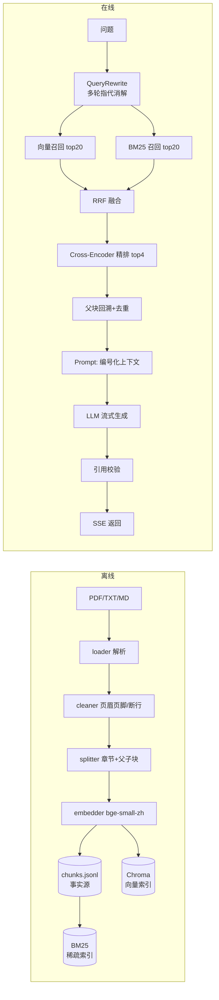

# DocQA · 可评测的中文文档问答系统

> 上传 PDF/TXT/Markdown → 结构化切分 → 混合检索 → 精排 → 带引用的回答 → 可量化的评测闭环。
> **不是"调个 API 的 Demo"**：核心在检索质量、引用可信度和工程闭环。

<p align="left">
  
  
  
  
  
</p>

---

## 一、它解决什么问题

企业/学校文档（规章、手册、合同、SOP）有三个特点：**长、结构化、还在更新**。
直接用大模型问答会瞎编，直接微调成本高且改不了。

这个项目把"文档问答"拆成可优化的四步，每一步都有指标：

| 环节 | 做了什么 | 怎么衡量 |
|---|---|---|
| 解析切分 | 页眉页脚清洗、章节识别、父子块切分 | 块大小分布、父块覆盖率 |
| 检索 | 向量 + BM25 双路召回 → RRF 融合 → Cross-Encoder 精排 | recall@4/10/20、MRR |
| 生成 | 编号化上下文、强制引用、无答案就说"未提及" | 引用准确率、拒答准确率 |
| 工程 | 流式 SSE、trace 日志、限流、Docker、45 个测试 | 延迟 P50/P95、测试通过率 |

---

## 二、实测结果（真实跑出来的，不是编的）

数据集：贵州民族大学《学生手册》272 页 / 15.9 万字 → **874 个子块**（均 178 字）/ **118 个父块**（均 1309 字）。
评测集：45 条（40 条可回答 + 5 条无答案），gold chunk 由高区分度关键词自动对齐。

```bash
python scripts/eval.py --presets vector_only,bm25_only,hybrid,hybrid_rerank
```

| 配置 | recall@4 | recall@10 | recall@20 | MRR | P50 延迟 |
|---|---|---|---|---|---|
| 纯向量 | 0.4667 | 0.7333 | 0.8444 | 0.3667 | 17ms |
| 纯 BM25 | 0.7333 | 0.8222 | 0.8444 | 0.5667 | 2ms |
| 混合（RRF） | 0.6222 | 0.8222 | 0.8444 | 0.4796 | 19ms |
| **混合 + 精排** | **0.8000** | 0.8222 | 0.8444 | **0.6759** | 2770ms |

**三个必须讲清楚的结论**（面试官最爱追问这里）：

1. **召回上限（recall@20 = 0.8444）四种配置完全一样** —— 说明瓶颈不在"能不能捞到"，
   而在"排序"。精排把 recall@4 从 0.62 拉到 0.80、MRR 从 0.48 拉到 0.68，代价是 2.7 秒延迟。
   **这就是两阶段检索存在的理由，也是下一步该优化的地方。**
2. **纯 BM25 的 recall@4 反而高于混合** —— 这是评测方法的偏差，不是结论：
   gold chunk 是用原文关键词对齐出来的，天然偏袒字面匹配。要公平比较，评测集里必须有
   "同义改写、口语化提问"的样本，这是我下一步要补的维度。
3. **延迟账要算清**：精排 20 条在 CPU 上约 2.7s，是本地链路最慢的一环。
   降到 10 条候选能省一半，或者上 GPU / 换更小的 reranker。

> 回答质量（关键词命中、引用准确率、拒答率）需要真实大模型 API Key，
> 填好 `.env` 后运行 `python scripts/eval.py --presets hybrid_rerank --with-answer` 即可产出。
> 没有 Key 时系统自动降级为 Mock 模式，链路完整可演示，但答案不可作为效果参考。

---

## 三、架构



**分层**：`ingest → embedding → store → retrieval → llm → rag → agent → api → web`，
`src/docqa/services.py` 是唯一的装配入口。

---

## 四、核心设计决策

| 决策 | 选择 | 为什么 | 代价 |
|---|---|---|---|
| 切分 | 章节结构 + 子块 400 / 父块 1200 | 小块检索准、大块上下文全 | 索引变大，需父块去重 |
| Embedding | bge-small-zh-v1.5（512 维 / 95MB） | CPU 可跑，入库 874 块 31 秒 | 效果不如 bge-m3（2.2GB） |
| 召回 | 向量 + BM25 双路 | 语义 + 字面互补，条款号/专有名词靠 BM25 | 多一路索引与延迟 |
| 融合 | RRF（k=60） | 只看名次，跨模型稳，不用调权重 | 丢掉了分数幅度信息 |
| 精排 | bge-reranker-base，只对 20 条做 | 逐词交互更准，全量算不起 | 2.7s（CPU），最大延迟来源 |
| 存储 | JSONL 事实源 + Chroma 派生索引 | 换模型可重建，原文不丢 | 两份数据要同步 |
| 生成 | DeepSeek（OpenAI 兼容） | 便宜、中文好、接口通用 | 依赖外部服务 |
| Agent | 手写 ReAct，不用框架 | 100 行可控可调试，面试能讲到代码级 | 没有框架的多 Agent 编排能力 |
| 前端 | Streamlit 只调 HTTP | 前后端可独立部署/替换/压测 | 多一层网络开销 |

---

## 五、快速开始

```powershell
# 1) 环境（Python 3.10+，实测 3.12）
python -m venv .venv
.\.venv\Scripts\activate
pip install -e ".[dev,cn]" -i https://pypi.tuna.tsinghua.edu.cn/simple

# 2) 配置（不填 Key 也能跑，会降级成 Mock 模式）
copy .env.example .env
#   编辑 .env：DOCQA_LLM__API_KEY=sk-xxxx

# 3) 入库（首次会从 ModelScope 下载 bge 模型，约 95MB）
python -m docqa.cli

# 4) 启动
python -m uvicorn docqa.api.main:app --port 8000    # 后端 + Swagger: /docs
python -m streamlit run apps/web/app.py             # 前端: http://127.0.0.1:8501

# 5) 验证
python scripts/smoke_test.py                        # 13 项接口冒烟
python -m pytest -q                                 # 45 个单元测试
python scripts/demo.py                              # 一键演示，产出 markdown 记录
```

Docker：`docker compose up --build`（api:8000 + web:8501）。

---

## 六、接口

| 方法 | 路径 | 说明 |
|---|---|---|
| GET | `/api/v1/health` | 健康检查（含模型与索引状态） |
| GET | `/api/v1/config` | 前端需要的非敏感配置（有测试断言不泄露密钥） |
| GET | `/api/v1/documents` `/stats` | 文档列表 / 索引统计 |
| POST | `/api/v1/documents/upload` | 上传并入库（PDF/TXT/MD） |
| DELETE | `/api/v1/documents/{id}` | 删除文档及其向量 |
| POST | `/api/v1/search` | **纯检索，不花 token**，返回四阶段得分 |
| POST | `/api/v1/ask` | RAG 问答（含引用、引用校验、debug） |
| POST | `/api/v1/ask/stream` | SSE 流式问答 |
| POST | `/api/v1/agent` | ReAct 多步任务 |
| GET | `/api/v1/metrics` | 请求数 / 错误数 / 平均延迟 / 索引统计 |

自建 Swagger 页面走 bootcdn，避免国内访问官方 CDN 白屏。

---

## 七、项目结构

```text
src/docqa/
├── ingest/      loader(解析) cleaner(清洗) headings(标题) splitter(切分) pipeline(编排)
├── embedding/   bge 本地模型 + 哈希兜底（测试不下载模型）
├── store/       chunk_repo(JSONL+manifest) chroma_store(向量) bm25_index(稀疏)
├── retrieval/   pipeline(编排) fusion(RRF/MMR) rerank(Cross-Encoder) query_rewrite
├── rag/         prompts(Prompt+引用校验) answerer(问答+流式)
├── agent/       react(ReAct循环) tools(4个工具+安全计算器)
├── api/         main(中间件/异常/限流) routes(10个接口)
└── eval/        evaluator(recall/MRR/引用/拒答)
apps/web/app.py  Streamlit 前端        scripts/  入库·评测·演示·冒烟
tests/           45 个测试             legacy/   v1 旧代码归档（演进对照）
docs/            学习手册 · 面试问答 · 演示指南
```

---

## 八、这个项目踩过的坑（都写进代码注释了）

1. **页眉页脚污染**：每页顶部的"学生手册"会进每个 chunk，把向量稀释成平均语义。
   用跨页重复率统计删掉（实测删了 1 种）。
2. **父块没比子块大**：第一版父块按章节聚合，平均 280 字，和子块差不多，
   small-to-big 完全失效。改成跨章节聚合后到 1309 字。
3. **`sentence_transformers.CrossEncoder` 精排输出异常**：20 条候选打分全挤在 0.730。
   直接 transformers 加载同一模型，logits 是 +2.46 / -3.74 / -10.20，区分度正常
   → 判定为封装层与 transformers v5 的兼容问题，改用 `AutoModelForSequenceClassification`。
4. **引用编号跨轮撞车**：Agent 每次 `search_docs` 内部编号从 1 开始，
   第二次调用会和第一次冲突 → 加全局重编号。
5. **"看起来正常但效果变差"**：换 embedding 模型不重建索引，是 RAG 最难查的 bug
   → manifest 记录模型与分块参数，启动时比对并告警。

---

## 九、已知限制

- 单机、单文档 874 块规模；没做过万级/多租户验证。
- 不做 OCR：扫描件只检测告警（`data/samples/t1.pdf` 就是例子）。
- 评测集 45 条，只能看方向性变化，看不了统计显著性。
- 没有线上流量，badcase 回流只设计了路径没落地。
- 精排 2.7s 是当前最大延迟来源，压到 10 条候选或上 GPU 是下一步。

---

## 十、文档

| 文档 | 内容 |
|---|---|
| [docs/项目学习手册.md](docs/项目学习手册.md) | 架构、逐层设计、数据流、配置速查、排错、扩展 |
| [docs/面试问答.md](docs/面试问答.md) | 57 个高频追问 + 回答框架（含"别说什么"） |
| [docs/演示指南.md](docs/演示指南.md) | 5 分钟演示脚本、常见提问应对 |

---

## License

MIT
